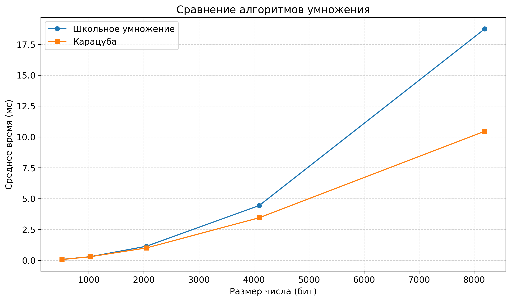
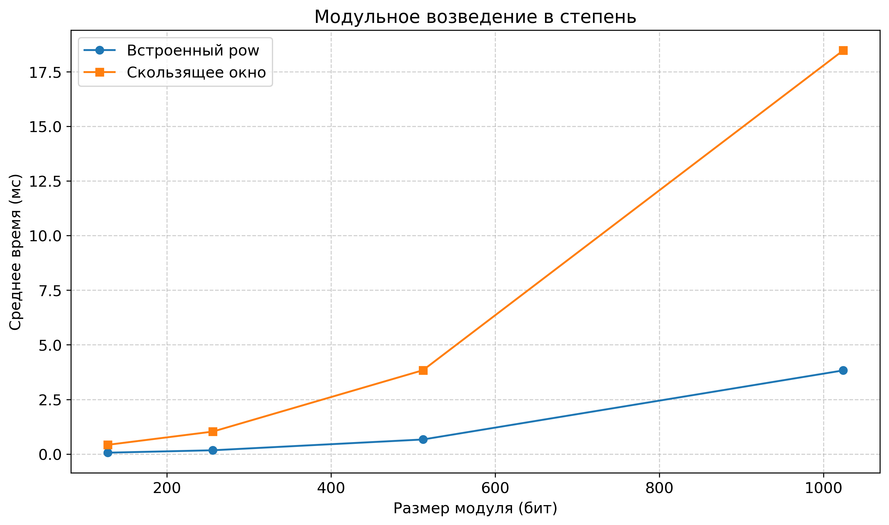
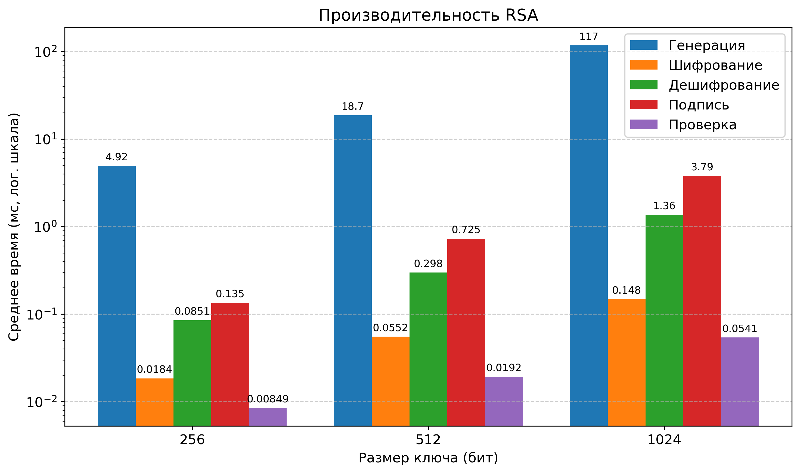
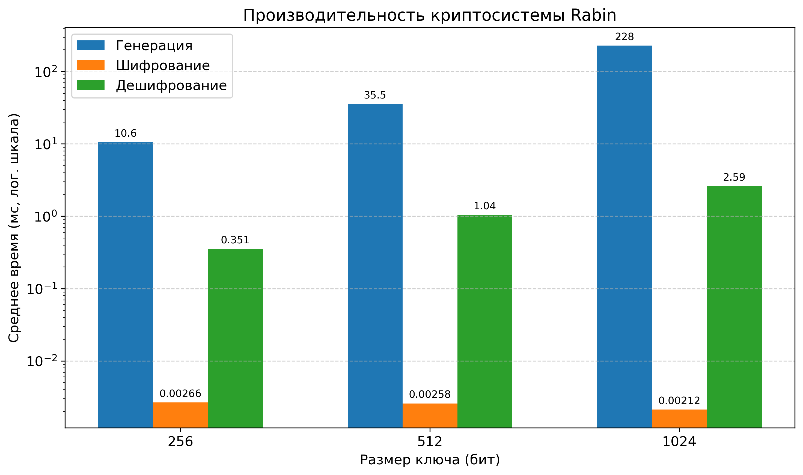
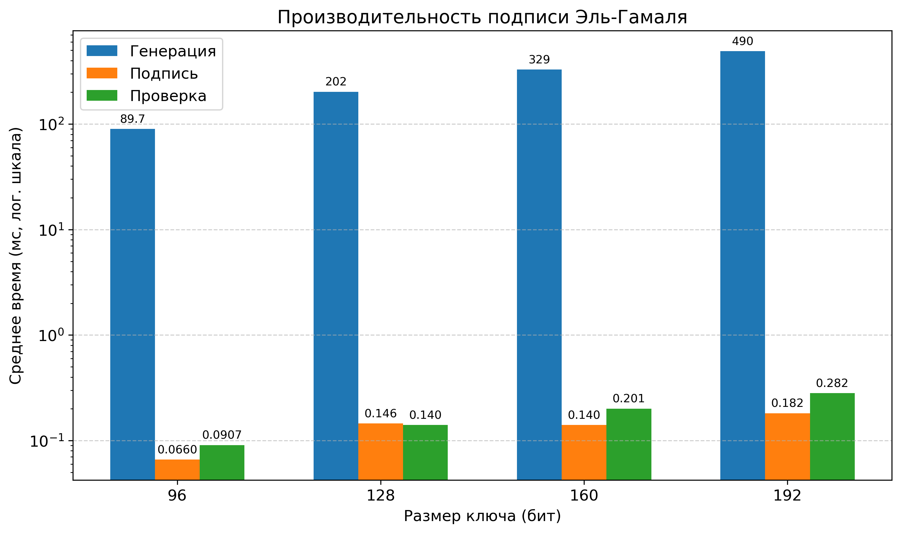
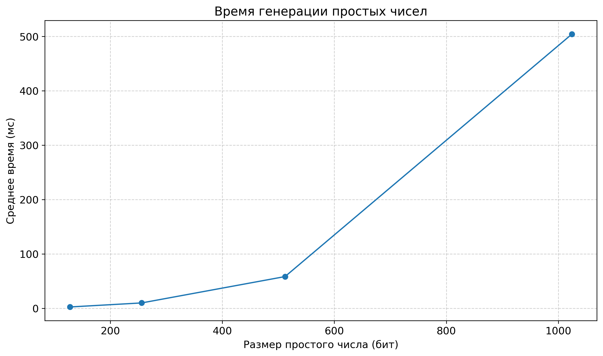
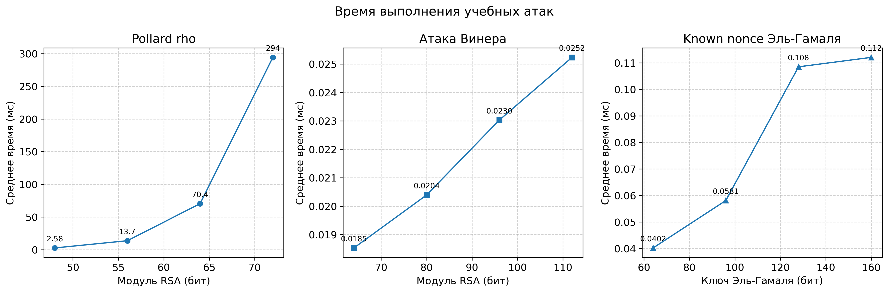

# Асимметричная криптография и арифметика больших целых чисел

Учебно-исследовательский проект.

Проект разработан в рамках выпускной квалификационной работы и включает реализации алгоритмов, экспериментальные измерения производительности, графики и демонстрации отдельных криптографических атак.

## Возможности

### Арифметика больших целых чисел

- Собственное представление `BigInt32` на основе 32-битных блоков.
- Умножение столбиком и алгоритм Карацубы.
- Модульное возведение в степень методом скользящего окна.
- Сравнение производительности с операциями над встроенными целыми числами Python.

### Тестирование простоты чисел

- Тест Миллера — Рабина.
- Тест Люка — Лемера для чисел Мерсенна.
- Генерация простых чисел.
- Проверка отдельных граничных случаев и больших чисел.

### Асимметричная криптография

- **RSA:** генерация ключей, шифрование, расшифрование, создание и проверка цифровой подписи.
- **Криптосистема Рабина:** операции шифрования и расшифрования.
- **Криптосистема Эль-Гамаля:** шифрование и цифровые подписи.

### Демонстрация криптографических атак

В проекте реализованы демонстрации отдельных атак на намеренно ослабленные или уязвимые конфигурации:

- Метод факторизации Полларда ро.
- Атака Винера на RSA при достаточно малом закрытом показателе.
- Восстановление закрытого ключа Эль-Гамаля при известном одноразовом параметре подписи.

## Эксперименты и производительность

В проект входят скрипты для измерения производительности и визуализации результатов.

Исследуются:

- Сравнение умножения столбиком и алгоритма Карацубы.
- Производительность модульного возведения в степень.
- Генерация простых чисел и тестирование простоты.
- Генерация ключей и криптографические операции RSA и Рабина.
- Создание цифровых подписей Эль-Гамаля.
- Производительность отдельных методов факторизации и криптографических атак.

Результаты экспериментов сохраняются в CSV-файл и представляются в виде графиков.

### Графики экспериментов

**Умножение больших целых чисел**



**Модульное возведение в степень**



**Криптосистема RSA**



**Криптосистема Рабина**



**Цифровые подписи Эль-Гамаля**



**Генерация простых чисел**



**Криптографические атаки**



Результаты зависят от оборудования, версии Python, размеров входных данных и условий проведения экспериментов. Полученные измерения характеризуют конкретную реализацию и не являются универсальными оценками производительности алгоритмов.

## Структура проекта

```text
Diplom/
├── chapter3_01_bigint_primality.py
├── chapter3_02_public_key_protocols.py
├── chapter3_03_benchmarks_attacks.py
├── benchmark_graphs.py
├── benchmark_results.csv
├── graph_attacks.png
├── graph_elgamal_signature.png
├── graph_modular_exponentiation.png
├── graph_multiplication.png
├── graph_prime_generation.png
├── graph_rabin.png
└── graph_rsa.png
```

- `chapter3_01_bigint_primality.py` — арифметика больших целых чисел, тесты простоты и генерация простых чисел.
- `chapter3_02_public_key_protocols.py` — реализации криптографических алгоритмов с открытым ключом.
- `chapter3_03_benchmarks_attacks.py` — измерение производительности и демонстрация криптографических атак.
- `benchmark_graphs.py` — построение графиков по результатам экспериментов.
- `benchmark_results.csv` — сохранённые результаты измерений.

## Запуск экспериментов

Запуск экспериментов:

```bash
python chapter3_03_benchmarks_attacks.py
```

Построение графиков:

```bash
python benchmark_graphs.py
```

## Используемые технологии

- Python
- Теория чисел и модульная арифметика
- Асимметричная криптография
- Алгоритмический анализ
- Измерение производительности
- Обработка CSV и визуализация результатов
